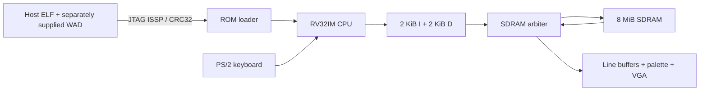

# DOOM on Cyclone II

A custom 50 MHz RISC-V computer running DOOM on an Altera Cyclone II FPGA.

**Hardware result: 2.447 FPS at 320×200.** The first release pairs the physically
working Phase 9 RV32IM bitstream with its matching firmware. This is a bare-metal
computer: custom CPU, caches, SDRAM controller, VGA scanout and PS/2 input.

[Download v0.1.0](https://github.com/clementnie/cyclone-ii-doom/releases/tag/v0.1.0) ·
[Build and program](docs/build.md) · [Measurements](docs/performance.md) ·
[Architecture](docs/architecture.md)

## Hardware

| Component | Configuration |
| --- | --- |
| Board | Cyclone II Starter Board / DE1; check PCB revision before using pins |
| FPGA | EP2C20F484C7; 18,752 logic elements, 52 M4Ks |
| Clock | 50 MHz CPU/SDRAM logic; 25 MHz VGA pixel enable |
| CPU | Custom RV32IM, interlocked fetch/operand/execute, overlapping fetch queue |
| Caches | Independent 2 KiB instruction + 2 KiB data, direct mapped |
| Memory | 8 MiB external x16 SDRAM; 8 KiB ROM + 8 KiB on-chip RAM |
| Video | 320×200 indexed framebuffer, doubled to 640×400 in 640×480 raster |
| Input / loading | PS/2 keyboard; USB-Blaster JTAG ISSP packet loader with CRC32 |
| Phase 9 fit | 14,732 LEs, 52 M4Ks, eight 9-bit multiplier elements, one PLL |



## Running it

Download the release assets and verify `SHA256SUMS`. Supply your own lawfully
obtained compatible IWAD; no WAD is included. Follow [the programming guide](docs/build.md)
for the exact SOF/ELF pair and manual SRAM programming commands. No Flash is needed.

```sh
git clone git@github.com:clementnie/cyclone-ii-doom.git
cd cyclone-ii-doom
git checkout v0.1.0
python3 phase9/tools/check_release.py
python3 phase9/tools/analyze_hardware.py phase9/reports/hardware-A.txt phase9/reports/hardware-B.txt
```

The software renderer draws actual textured walls, floors, ceilings and sprites.
The platform copies indexed pixels into the back SDRAM slot, updates the RGB444
palette during vblank and requests a vblank slot flip. VGA DMA uses alternating
line buffers. Rendering is CPU work; the FPGA does not accelerate DOOM geometry.
No genuine hardware photograph or physical VGA capture was available for this
publication. Existing simulation captures are deliberately not presented as hardware photos.

## Results and development

| Revision | Evidence | FPS |
| --- | --- | ---: |
| Phase 7, RV32I + 4 KiB instruction cache | Physical measurement recorded during development | 0.815 |
| Phase 9, RV32IM + split caches | Physical counter logs, 118 frames / 48.227 s | 2.447 |
| Phase 10 original candidate, reduced sampling | Short startup simulation only | approximately 5.41 |

Phase 10 explores ChromatiX-inspired selective rendering, packed presentation,
32-byte cache lines and SDRAM block buffers. Its original physical upload failed
CRC readback. A conservative read-cadence hotfix passes recorded simulations but
has no physical gameplay result. **Phase 10 is experimental and is not the release.**
The 5.41 FPS startup result predates that hotfix. No 20–30 FPS result is claimed.

Historical `phase*/` paths remain because firmware, regression harnesses and
Quartus source lists share files across phases. Start with `phase9/`; see the
[repository map and history](docs/development.md) before moving files.

## Limitations

Low gameplay frame rate; no audio, networking, OS or privileged RISC-V execution.
Traps halt the CPU. The pipeline is conservatively interlocked rather than fully
forwarded. All M4Ks are occupied. Palette changes use polling rather than an
atomic shadow palette. Enter is not decoded; menu interaction is limited.
The release has recorded physical evidence, not a new independent board test
performed during publication. Timing reports do not establish PCB signal integrity.

## Documentation and credits

- [Architecture and memory map](docs/architecture.md)
- [Hardware and wiring](docs/hardware.md)
- [Build, programming and rollback](docs/build.md)
- [Performance evidence](docs/performance.md)
- [Development and future releases](docs/development.md)
- [Troubleshooting](docs/troubleshooting.md)
- [Licenses, attribution and exclusions](NOTICE.md)

DOOM by id Software; port based on [doomgeneric](https://github.com/ozkl/doomgeneric).
Compiler support comes from LLVM compiler-rt. Phase 10 adaptations credit
[Enjoy-Digital / ChromatiX](https://github.com/enjoy-digital/chromatix).
Original project code is published under GPL-2.0-or-later; third-party terms
remain in their own notices. Game data and Altera tools are separate.
