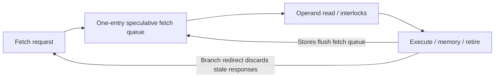

# Architecture

The released design is Phase 9. Its Quartus top is `starter_phase9` in
`phase9/rtl/starter_phase9.v`; its explicit source list is `phase9/quartus/phase9.qsf`.

## CPU evolution

Early phases implement a multicycle RV32I machine with precise stopping traps,
naturally aligned accesses and a request/ready bus. Phase 7 adds a coherent
4 KiB instruction cache. Phase 8 experiments with open-row SDRAM. Phase 9 adds
all eight RV32M operations and overlaps fetch with an interlocked backend.
Multiplication uses registered DSP logic; division uses 32 restoring steps,
including architectural divide-by-zero and signed-overflow behavior.

Branches resolve in execute. Operand read and execution serialize dependencies;
there is no claim of one retired instruction each clock. Reset invalidates caches
and architectural state. Bad alignment and illegal transactions retain fault behavior.

## Caches and SDRAM

Phase 9 divides the 4 KiB data capacity into independent 2 KiB I/D direct-mapped
caches, each with one-word lines and synchronous tag/data RAM. D reads allocate;
writes are write-through, no-write-allocate and conservatively invalidate both
banks at the index. MMIO, ROM and on-chip RAM bypass caches. Stores commit before
acknowledgment, so the display sees committed SDRAM data without dirty-line hazards.

The x16 SDRAM controller uses open-row tracking, CL2 and BL1 commands. Address
mapping is bank bits [22:21], row [20:9], column [8:1]. Two halfword operations
serve a word. DQM handles byte lanes. Refresh is scheduled between transactions;
VGA and CPU share an arbiter with video priority and bounded service/fairness.
The PLL supplies the external SDRAM clock with an 8 ns phase shift.

| Address | Function |
| --- | --- |
| `0x00000000–0x00001fff` | 8 KiB boot ROM |
| `0x00010000–0x00011fff` | 8 KiB on-chip RAM |
| `0x10002000` | PS/2 event and state registers |
| `0x10003000` | Diagnostic VGA controls |
| `0x10004000` | Mailbox, cycle count and diagnostic state |
| `0x10006000` | Framebuffer control/status; palette at `0x10006400` |
| `0x10007000` | JTAG loader mailbox |
| `0x10010000` | Diagnostic text tiles |
| `0x20000000–0x207fffff` | 8 MiB SDRAM |
| `0x20000000`, `0x20010000` | Two 64 KiB framebuffer slots |
| `0x20020000` | Engine ELF entry / linked image |
| `0x20380000` | Reserved resident IWAD base |
| `0x207f0000–0x207fffff` | Reserved 64 KiB stack region |

See `phase9/link.ld`, `phase9/rtl/phase9_bus.v` and `phase4b/rtl/framebuffer.v`
for exact register behavior. The heap ends at the IWAD base; the uploader rejects
segments that cross reservations and IWADs that exceed their slot.

## VGA and input

Two 320-byte scanline buffers alternate DMA refill and display. Each indexed pixel
selects one of 256 RGB444 palette entries. Pixels and rows double into a 640×400
letterbox, centered vertically in an 800×525 total raster at a 25 MHz pixel enable.
Frame slots switch at vblank. Scanline status lets firmware place palette writes
in a safe interval; there is no atomic shadow palette.

The PS/2 receiver synchronizes and filters clock/data, checks serial frames and
handles Set-2 prefixes and release sequences. It is receive-only: no keyboard
configuration, LEDs or resend negotiation. Arrow keys, Ctrl/fire, Space/use and
Escape/menu are mapped by `phase9/platform.c`; Enter remains unsupported.

## Loader and engine

The ROM loader receives RESET, BEGIN, DATA, END and EXEC transactions over a
480-bit source / 96-bit probe ISSP mailbox. END computes CRC32 from actual SDRAM;
EXEC transfers control only after verified segments and IWAD. Quartus 13 can
report the five-character DOOM6 instance as OOM6; discovery validates widths and
identity rather than assuming one string length.

The bare-metal runtime supplies memory-backed WAD I/O, allocation, strings,
formatting and compiler helpers. doomgeneric supplies the engine callbacks.
Phase 9 builds RV32IM/ILP32 at O2 without strict aliasing. Textured columns and
spans remain engine calculations. Phase 10 selectively samples 160×100 while
retaining the 320×200 coordinate system; see `phase10/RESEARCH.md` and `HOTFIX.md`.
